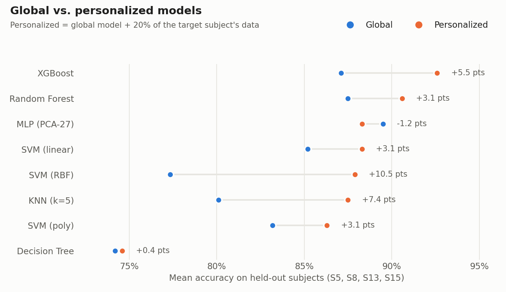
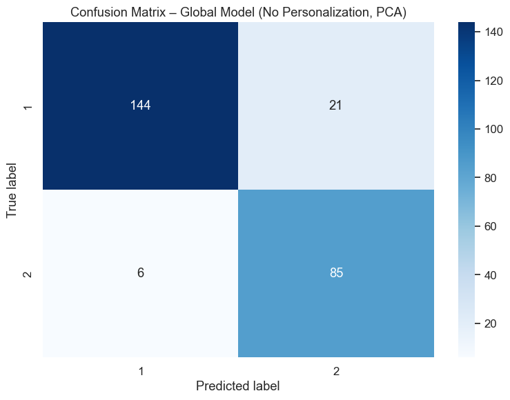
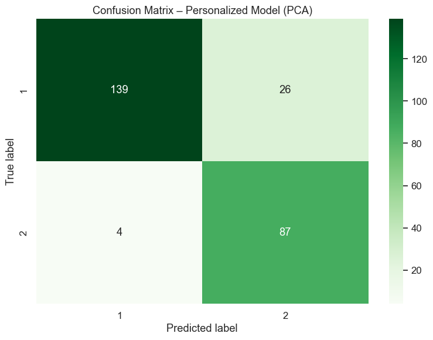
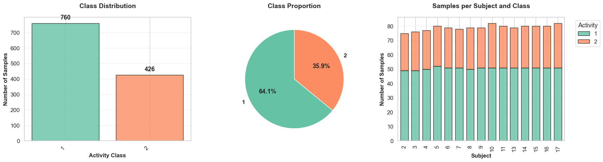
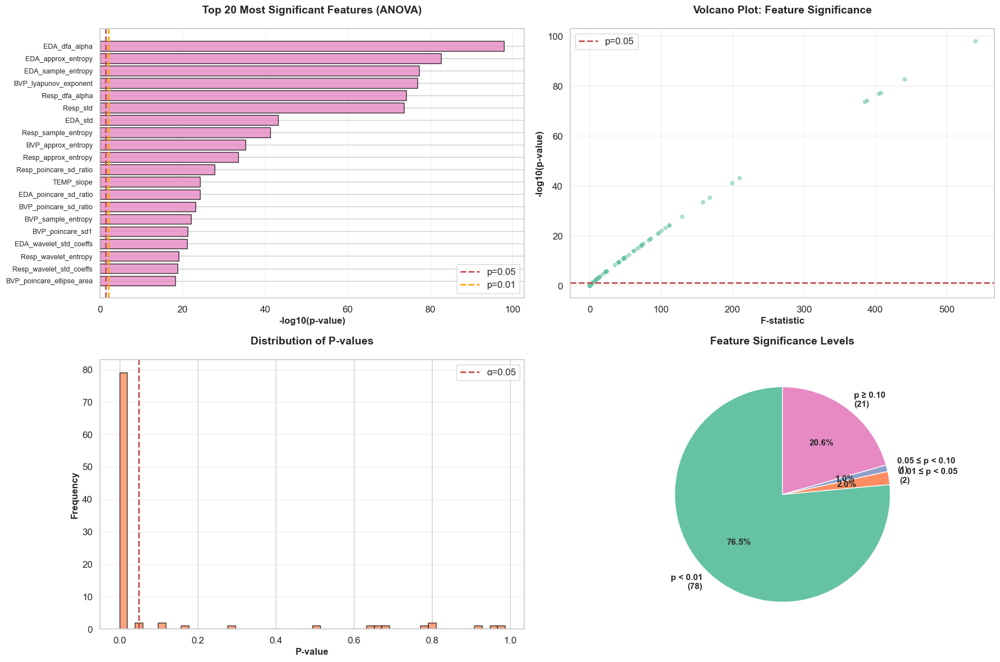
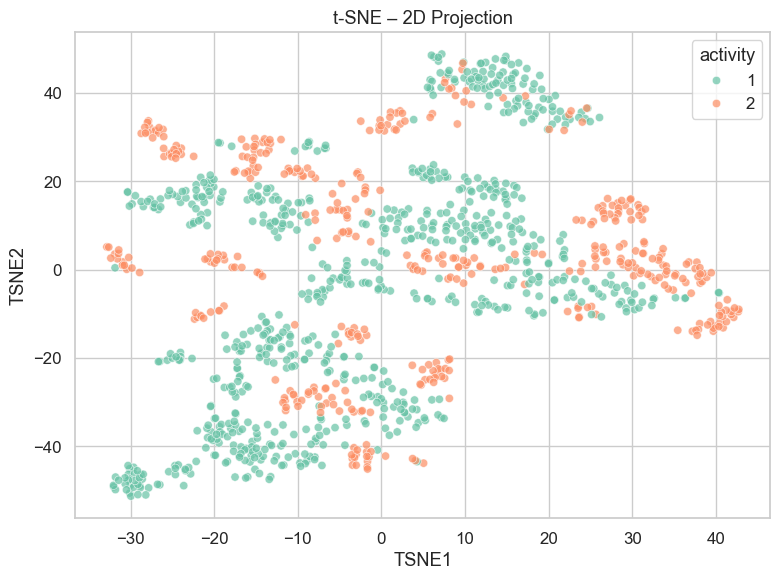

# Stress Classification from Wearable Physiological Signals (WESAD)

Course project for **MEC E 694 (University of Alberta), Fall 2025**.

An end-to-end Python/Jupyter pipeline that detects stress from wrist-worn physiological signals in the [WESAD](https://archive.ics.uci.edu/dataset/465/wesad+wearable+stress+and+affect+detection) dataset. It covers signal preprocessing, feature extraction, dimensionality reduction, supervised classification (global vs. personalized models), and unsupervised clustering.

## Pipeline

1. **Preprocessing and windowing** of the Empatica E4 wrist signals (EDA, BVP, TEMP, ACC) plus respiration, sampled at their native rates.
2. **Feature extraction**
   - *Time domain:* mean, std, min and max for each signal and axis, net acceleration, temperature slope
   - *Frequency domain:* BVP peak frequency
   - *EDA decomposition:* tonic, phasic and sparse (SMNA) components using **cvxEDA**
   - *Phase-space:* Poincaré-plot descriptors (SD1, SD2, SD1/SD2 ratio, ellipse area)
3. **Exploratory analysis:** class distributions, feature correlations, statistical significance tests, and discriminative-feature ranking.
4. **Dimensionality reduction:** PCA (27 components keep ≥95% of the variance), kernel PCA (RBF, sigmoid), t-SNE, an autoencoder, and a VAE latent space.
5. **Supervised classification (baseline vs. stress)**
   - MLP, KNN, Decision Tree, SVM (linear/RBF/poly), Random Forest, XGBoost
   - Hyperparameter tuning with **Optuna**
   - **Leave-One-Subject-Out (LOSO)** cross-validation
   - **Global vs. personalized models:** a global model trained on 11 subjects, then fine-tuned on 20% of each held-out subject's data
6. **Unsupervised clustering:** K-Means, GMM and spectral clustering in PCA and autoencoder-latent spaces.

## Key results



| Model | Global accuracy | Personalized accuracy |
|---|---|---|
| XGBoost | 0.871 | **0.926** |
| Random Forest | 0.875 | 0.906 |
| SVM (linear) | 0.852 | 0.883 |
| SVM (RBF) | 0.773 | 0.879 |
| KNN (k=5) | 0.801 | 0.875 |
| MLP (PCA-27) | 0.895 | 0.883 |

- MLP LOSO accuracy on the 11 global subjects: **0.866**.
- Personalization improved every classical model, with the largest gains for SVM-RBF (+10.5 pts) and KNN (+7.4 pts).
- Accuracies are averaged over the 4 held-out "personal" subjects (S5, S8, S13, S15).

**MLP confusion matrices on the held-out subjects** (1 = baseline, 2 = stress)

| Global model | Personalized model |
|---|---|
|  |  |

## Data exploration

**Dataset balance:** 1,186 windows from 15 subjects (64% baseline, 36% stress).



**Feature significance:** 78 of the 102 features differ significantly between baseline and stress (ANOVA, p < 0.01). Nonlinear EDA, BVP and respiration features rank highest: DFA alpha, entropy measures, and the Lyapunov exponent.



**t-SNE embedding of the feature space:** baseline and stress form many small, separate clusters rather than two clean groups.



## Repository structure

```
├── notebooks/
│   ├── 01_feature_extraction.ipynb            # raw WESAD .pkl -> windowed features (incl. cvxEDA)
│   ├── 02_feature_pipeline_exploration.ipynb  # first pass: PCA, t-SNE, RF tuning, autoencoder, LOSO
│   └── 03_stress_classification.ipynb         # final analysis: EDA, kernel PCA, global vs personalized, clustering
├── data/
│   └── wesad_features_with_phase_space.csv    # extracted feature table used by notebooks 02 and 03
├── figures/                                   # plots shown in this README
├── requirements.txt
├── LICENSE
└── README.md
```

## Getting started

```bash
pip install -r requirements.txt
jupyter notebook notebooks/03_stress_classification.ipynb
```

Notebooks 02 and 03 run directly on the included feature CSV.

To regenerate features from raw signals with notebook 01:

1. Download WESAD from the [UCI repository](https://archive.ics.uci.edu/dataset/465/wesad+wearable+stress+and+affect+detection). The raw data is not included here because of its size (about 13 GB) and the dataset's license terms.
2. Place the subject files at `data/WESAD/S2.pkl … S17.pkl`.

## Credits

- **Dataset:** P. Schmidt, A. Reiss, R. Duerichen, C. Marberger, K. Van Laerhoven. *Introducing WESAD, a Multimodal Dataset for Wearable Stress and Affect Detection.* ICMI 2018.
- **cvxEDA:** A. Greco, G. Valenza, A. Lanata, E. P. Scilingo, L. Citi. *cvxEDA: A Convex Optimization Approach to Electrodermal Activity Processing.* IEEE TBME 2016 ([original code](https://github.com/lciti/cvxEDA), GPL-3.0).
- **Low-pass filter helpers:** adapted from [MIT eda-explorer](https://github.com/MITMediaLabAffectiveComputing/eda-explorer).

## License

This project is released under the [MIT License](LICENSE).

The `cvxEDA` function in `notebooks/01_feature_extraction.ipynb` is third-party code by Greco et al. and remains under its original [GPL-3.0 license](https://github.com/lciti/cvxEDA).
